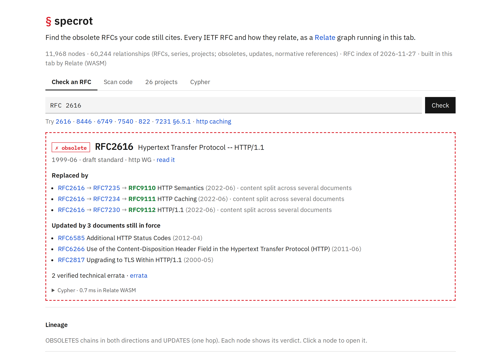
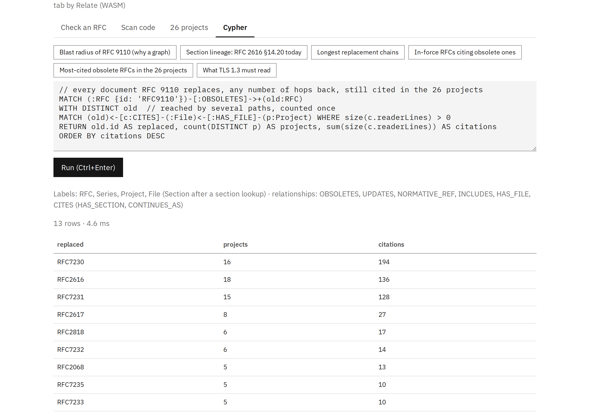

# specrot

Find the obsolete RFCs your code still cites. specrot puts every IETF RFC and how they relate into one
Relate graph file, so a developer, a CI job or a coding agent can ask "is this still the spec, and
if not, what replaced it?"

**Try it:** [live explorer](https://shiran-yu.github.io/specrot/) (Relate WASM in the browser, no install) ·
`git clone https://github.com/shiran-yu/specrot && cd specrot && uv run specrot check 2616` (the graph ships
in the repo) · **Evidence:** 1,603 of 8,034 RFC citations in 26 major codebases point at obsolete RFCs
([below](#use-case), method in [EVIDENCE.md](EVIDENCE.md)).

```console
$ uv run specrot check 8446
✗ OBSOLETE  RFC8446  The Transport Layer Security (TLS) Protocol Version 1.3  (2018-08, Proposed Standard)
├── replaced by (OBSOLETES chains to documents still in force)
│   └── RFC8446 → RFC9846  The Transport Layer Security (TLS) Protocol Version 1.3  (new edition of the same specification)
└── 11 verified technical errata  https://www.rfc-editor.org/errata/rfc8446
```

[](https://shiran-yu.github.io/specrot/#rfc=2616)

## Use case

Protocol code is full of comments like `// see RFC 7230, section 3.3.2`. RFCs are never edited
after publication; they are *obsoleted* or *updated* by later RFCs. HTTP/1.1 has been rewritten
twice since RFC 2616 (RFC 7230–7235 in 2014, RFC 9110–9112 in 2022), TLS 1.3's own RFC 8446 was
replaced by RFC 9846 in July 2026, and OAuth 2.0 (RFC 6749) is amended by a security best practice
(RFC 9700) that rules out parts of it, such as the implicit grant (`specrot check 6749` lists it under
"updated by"). A citation that was right when it was written quietly
starts pointing a reader, a reviewer or an AI coding agent at the wrong text.

**Who benefits:** maintainers of protocol libraries (HTTP clients and servers, TLS stacks, DNS,
mail, OAuth/JWT), security reviewers checking that an implementation follows the current spec,
and coding agents, whose training data predates recent replacements.

**Evidence in short** ([EVIDENCE.md](EVIDENCE.md) has the method, the caveats and the scripts):

| Question | Answer |
|---|---|
| Does real code cite obsolete RFCs? | **1,603 of 8,034** RFC citations in 26 major codebases (20%), in 24 of the 26 (25 repositories: Go's `net` and `crypto` are counted apart) |
| Are they worth fixing? | About half: two models labelling 100 of them agree on 49 (the rest are deliberate references or scanner errors) |
| Do maintainers fix them? | Yes, by hand: 17 merged PRs replaced 106 obsolete citations; `fix` proposes 50 of those edits, 47 with the maintainers' RFC |
| Do coding agents get it right? | Without tools Claude Haiku 5.5 names an obsolete RFC for 8 of 34 protocols and Sonnet 5.5 for 2 (the two replaced in 2026); with web search 1 and 2; with the specrot MCP server, 0 |
| Upstream | PRs open (not merged) at [nginx#2051](https://github.com/nginx/nginx/pull/2051) and [httpx#3874](https://github.com/encode/httpx/pull/3874) |

**Which relationships matter:**

| Question | Graph walk |
|---|---|
| What replaced this RFC? | follow `OBSOLETES` backwards, any length, to documents nobody obsoletes (`2616 → 7230 → 9112`); each edge has a `kind`: new *edition*, newer protocol *version*, *split* into several documents, or *retired* by a deprecation notice |
| Is it still in force but changed? | `UPDATES` from documents still in force; titles saying *Deprecating/Prohibiting* are flagged; verified technical `Erratum` nodes |
| What must I read to implement it? | `NORMATIVE_REF` closure, references to `BCP`/`STD` series resolved to member RFCs, obsolete targets swapped for replacements |
| Who is affected if it changes? | `NORMATIVE_REF` backwards from documents still in force |
| Where does section 6.5.1 of RFC 7231 live now? | `(:Section)-[:CONTINUES_AS]->+(:Section)` to a section of a document still in force: §6.5.1 *400 Bad Request* → RFC 9110 §15.5.1; 2616 §14.20 → 7231 → 9110 §10.1.1 |
| Which projects still cite it? | `(:Project)-[:HAS_FILE]->(:File)-[:CITES]->(:RFC)` |

## Why a graph, not a table

Every answer specrot gives is a walk of unknown length across several kinds of node, which a lookup table
cannot hold and SQL needs a recursive CTE plus a join per hop for:

[](https://shiran-yu.github.io/specrot/#cypher)

```cypher
// Blast radius of a new RFC: every document it replaces, any number of hops back, still cited in the projects
MATCH (:RFC {id: 'RFC9110'})-[:OBSOLETES]->+(old:RFC)<-[c:CITES]-(:File)<-[:HAS_FILE]-(p:Project)
RETURN count(DISTINCT old) AS replaced, count(DISTINCT p) AS projects, sum(size(c.readerLines)) AS lines
```

RFC 9110 (HTTP Semantics, 2022) replaces 13 documents through chains such as 2616 → 7231 → 9110; they are
still cited on **1,183** lines in **20** of the 26 projects. The same query for TLS 1.3's new RFC 9846 (July
2026) gives 518 lines in 8 projects, older TLS versions included. One edge type answers "what replaced it",
another "which section", a third "who cites it", and the question chains them:

```cypher
// Where does RFC 2616 §14.20 live today? Section lineage across two rewrites
MATCH p = (:Section {id: 'RFC2616#14.20'})-[:CONTINUES_AS]->+(t:Section)
RETURN [x IN nodes(p) | x.id + ' ' + x.title]    // RFC2616#14.20 Expect → RFC7231#5.1.1 → RFC9110#10.1.1
```

Adding a scanned project, a new RFC or an erratum adds nodes and edges; no query changes. The CLI, the MCP
server and the browser explorer all run these Cypher queries against the same `store/rfc.rl`.

## How it uses Relate

- **Mode: single file** — [`store/rfc.rl`](store/rfc.rl) (8 MB).
- **Why this mode:** the graph is a dataset that ships with the code: one file to commit, clone,
  open read-only from the Python package, the `relate` CLI and the MCP server, and replace as a
  whole when the RFC index changes. Nothing to start, no server. Writes (`scan --save`) go to the
  same file; reads open it with `read_only=True`.
- **What the graph models:** 9,869 `RFC`s, 377 `Series` (BCP/STD/FYI), 8,215 `Erratum`, 532
  `WorkingGroup`s in 16 `Area`s, 51,653 `Section`s, and 26 scanned `Project`s with 2,442 `File`s.
  Relationships: 1,546 `OBSOLETES`, 2,172 `UPDATES`, 58,954 `NORMATIVE_REF`, 69,790 `INFORMATIVE_REF`,
  `INCLUDES`, `AMENDS`, `FROM_WG`, `IN_AREA`, `HAS_FILE`, `CITES`, `HAS_SECTION`, and 29,343
  `CONTINUES_AS` between sections of an RFC and its replacements (27,799 with an identical heading). Of the normative references,
  42,164 are RFC→RFC as recorded by the Datatracker, 8,112 point at a BCP/STD series, and 8,678 are
  derived from those series' members (marked `{via: 'BCP14'}`).
- **Relate features used:** embedded Python API (`relate-db`), Cypher 25 quantified path patterns
  (`(r)<-[:OBSOLETES]-+(n)`), hop-by-hop traversal over id sets for the normative closure,
  `EXISTS {}` / `COUNT {}` subqueries,
  uniqueness constraints and indexes, a BM25 `FULLTEXT INDEX` with the `SEARCH` clause, the
  `relate` CLI (`clone` to compact the store, `serve --mcp` / `--bolt` for exploration), and an MCP
  server of our own for agents.

```
(:RFC)-[:OBSOLETES {kind}]->(:RFC)           (:RFC)-[:UPDATES]->(:RFC)        (:Series)-[:INCLUDES]->(:RFC)
(:RFC)-[:NORMATIVE_REF|INFORMATIVE_REF]->(:RFC|:Series)
(:Erratum)-[:AMENDS]->(:RFC)                 (:RFC)-[:FROM_WG]->(:WorkingGroup)-[:IN_AREA]->(:Area)
(:Project)-[:HAS_FILE]->(:File)-[:CITES {lines, readerLines, sections}]->(:RFC)
(:RFC)-[:HAS_SECTION]->(:Section)-[:CONTINUES_AS {exact}]->(:Section)
```

## Setup and run

Prerequisites: Python 3.10+ and [uv](https://docs.astral.sh/uv/) (`curl -LsSf https://astral.sh/uv/install.sh | sh`).
No account, key or server.

```bash
git clone https://github.com/shiran-yu/specrot && cd specrot
uv run specrot check 2616 8446 6749     # first run installs dependencies (~10 s)
```

Without uv: `python -m venv .venv && . .venv/bin/activate && pip install -e . && specrot check 2616`.

**No install at all:** open the [in-browser explorer](https://shiran-yu.github.io/specrot/) (or
`python3 -m http.server -d docs 8000` in a clone, which works offline: Relate WASM and cytoscape are vendored in
`docs/vendor/`). It runs the Relate WebAssembly build in the tab
and rebuilds a subset of the graph there in about 3 s: RFCs, series, `OBSOLETES` with kinds,
`UPDATES`, the 50,842 RFC-level normative references and the 26 projects (no errata, working groups
or informative references; only files with reader-facing citations, so 1,705 `File`s rather than 2,442,
and only series with a member RFC), from [`docs/data/graph.json`](docs/data/graph.json), which
`scripts/export_web.py` exports because the WASM build cannot open a `.rl` file. The sections and
`CONTINUES_AS` load from `docs/data/sections.json` on the first section lookup
([`#rfc=7231&s=6.5.1`](https://shiran-yu.github.io/specrot/#rfc=7231&s=6.5.1)). It offers check
with a lineage graph and section lookup, paste-and-scan, the 26-project table with links to the exact lines on
GitHub, and a Cypher console.

Then:

```bash
uv run specrot scan /path/to/any/repo          # stale RFC citations, with file:line and the fix
uv run specrot scan . --markdown               # a table to paste into a PR
uv run specrot scan . --fail-on obsolete       # CI gate: exit 1 on obsolete citations
uv run specrot fix .                           # unified diff: RFC and section rewritten where unambiguous
uv run specrot check "RFC 7231 §6.5.1"         # where that section lives now (RFC 9110 §15.5.1)
uv run specrot read 9110 --depth 2             # normative reading list for an implementation (depth 1-3)
uv run specrot impact 5280                     # what still in force depends on RFC 5280 (depth 1-3)
uv run specrot check "BCP 14" "STD 66"         # series resolve to their member RFCs
uv run specrot search "token revocation"       # full-text search over titles and abstracts
uv run specrot cypher "MATCH (p:Project)-[:HAS_FILE]->()-[:CITES]->(r:RFC {id:'RFC2616'}) RETURN DISTINCT p.name"
```

### In CI

```yaml
# .github/workflows/specrot.yml
on: [pull_request]
jobs:
  specrot:
    runs-on: ubuntu-latest
    steps:
      - uses: actions/checkout@v4
      - uses: shiran-yu/specrot@main      # writes a report to the job summary, fails on obsolete citations
```

Citations that deliberately describe legacy behaviour go in a `.specrot-ignore` at the scanned root:

```
RFC5849  oauthlib/oauth1/*   # this module implements OAuth 1.0
RFC5246                      # we still ship TLS 1.2
*        docs/rfc-notes/*    # notes about old RFCs, any RFC
```

`specrot scan . --baseline` appends today's findings as such lines, so a CI gate added to an existing
project fails only on new stale citations. specrot's own repository passes its own gate in CI this way ([`.specrot-ignore`](.specrot-ignore)): its
examples and evaluation data cite old RFCs on purpose.

### For coding agents

MCP server (tools `check_rfcs`, `scan_path`, `scan_text`, `reading_list`, `dependents`,
`search_rfcs`, `get_schema`, `read_cypher`; bad input comes back as an error message that says how
to fix the call):

```bash
claude mcp add specrot -- uv run --directory "$PWD" specrot mcp
```

Skill: copy [`skills/specrot`](skills/specrot/SKILL.md) into `.claude/skills/` (or your agent's
skills folder). It tells the agent to check an RFC before citing or implementing it.

### Explore the raw graph

With the [Relate CLI](https://relatedb.ai/docs/get-started/install/)
(`curl -sSfL https://relatedb.ai/install.sh | bash`):

```bash
relate query --database store/rfc.rl --read-only                    # interactive Cypher shell
relate serve --database store/rfc.rl --read-only --mcp stdio        # Relate's own MCP server
relate serve --database store/rfc.rl --read-only --bolt 7687 --bolt-identity Neo4j/5.26.0
```

Some queries to try:

```cypher
// the longest replacement chain in the RFC series (32 hops, 1988 to 2013)
MATCH p = (old:RFC)<-[:OBSOLETES]-+(new:RFC)
WHERE NOT new.obsolete AND NOT EXISTS { (old)-[:OBSOLETES]->() }
RETURN length(p) AS hops, [x IN nodes(p) | x.id] AS chain, new.title ORDER BY hops DESC LIMIT 3;

// documents still in force that normatively cite an obsolete RFC
MATCH (a:RFC)-[:NORMATIVE_REF]->(b:RFC) WHERE NOT a.obsolete AND b.obsolete
RETURN b.id, b.title, count(a) AS citedBy ORDER BY citedBy DESC LIMIT 10;
```

## Where the data lives

- **Store:** [`store/rfc.rl`](store/rfc.rl), a single-file Relate store, committed.
- **Sources** (metadata only, no RFC full text): the
  [RFC Editor index](https://www.rfc-editor.org/rfc-index.xml), the
  [RFC Editor errata API](https://www.rfc-editor.org/api/v1/errata.json) (submitter names dropped),
  and normative/informative references from the
  [IETF Datatracker API](https://datatracker.ietf.org/api/v1/doc/relateddocument/).
- **Rebuild:** `uv run specrot build` downloads into `data/raw/` (git-ignored; ~1 min, plus ~40 min once for the 2,221 RFC texts used for sections) and rewrites
  the store; `uv run python scripts/showcase.py` re-scans the 26 projects at the commits pinned in
  [`scripts/showcase.json`](scripts/showcase.json).
- Code: [`specrot/build.py`](specrot/build.py) (graph model and load),
  [`specrot/graph.py`](specrot/graph.py) (all queries), [`specrot/scan.py`](specrot/scan.py),
  [`specrot/mcp_server.py`](specrot/mcp_server.py).

## Limits

- "Obsolete" is the RFC Editor's relation, not a judgement of the code. The edge `kind` (edition,
  version, split, retired) is inferred from the two titles at build time (deprecation wording;
  differing version numbers in a *protocol's* title, as in TLS 1.2 → 1.3, IMAP 4rev1 → 4rev2,
  a TLS 1.2 extension folded into a TLS 1.3 document, CT → CT 2.0,
  RTSP → RTSP 2.0, while PKCS #1 v2.1 → v2.2 is a new edition and IPv6 or HTTP/1.1 in a title is not
  a version change; tests in `tests/test_specrot.py::test_obsoletes_kind`; number of successors), so it can be wrong for an unusual title. All 55
  `version` edges are listed by `MATCH (n)-[e:OBSOLETES {kind:'version'}]->(o) RETURN o.title, n.title`.
  Two edges are marked `partial` by hand (`build.PARTIAL`: RFC 1738's telnet and gopher schemes moved to
  RFC 4248 and 4266, while URL syntax went to RFC 3986, which only *updates* 1738), so `fix` leaves those too.
  Six edges are marked `redesign` by hand, each with its reason (`build.REDESIGN`: RFC 6874 → 9844,
  TCP MD5 → TCP-AO, HTML 2.0 and form upload → text/html, BSD syslog → RFC 5424, Cookie2 → RFC 6265):
  the replacement is a different design, so `fix` leaves those citations to a person. Only the 76
  pairs `fix` proposes on the 26 projects were reviewed; other edges may hide the same case.
  Citations that deliberately describe legacy behaviour are reported like any other; list them in
  `.specrot-ignore`.
- Citations are found with a regular expression. Media types such as `message/rfc822` are skipped;
  identifiers (`time.RFC1123`, `rfc2822_date`) and test files are excluded by default
  (`--all-kinds` includes them).
- Sections are mapped by heading: a section continues as the section of the replacement with the
  same heading (a near-identical one is marked `~`/reworded and never rewritten by `fix`). Of the 287
  distinct obsolete (RFC, section) pairs cited in the 26 projects, 221 have a home in a current RFC
  (207 by identical heading; `facts.json` `sections`); a section whose content moved under a new heading
  gets none, and about 1% of headings parsed from the plain text are noise (addresses, ASN.1 lines). The
  headings come from the RFC Editor's plain-text RFCs (`data/raw/txt`, fetched by `specrot build`).
- `specrot fix` rewrites only unambiguous citations and prints a diff; it leaves code names
  (`RFC_4122`, `rfc_822`), protocol strings (`RFC822.TEXT`), quoted examples, lines that already talk
  about history or the replacement, and files that are not UTF-8 alone, and `--write` changes only the
  lines in the diff. It also skips chains that change protocol version and appendices named in prose.
  On a held-out sample of 100 edits (the fixer frozen first, no line seen in the earlier rounds), both
  model labelers called **74** mergeable as is and 9 wrong; 4 of the 9 were stale section numbers the
  pattern missed, fixed since, and 2 a section mapped by an identical heading whose content moved
  ([`scripts/fix_eval/RESULTS.md`](scripts/fix_eval/RESULTS.md), with the two earlier rounds). 34 to 42 of 100 stale citations are
  deliberate (the audit in [EVIDENCE.md](EVIDENCE.md)), so a person reviews the diff before committing.
- The Datatracker records references for most RFCs, but not for every early one (pre-1990s RFCs
  mostly have none).
- The store reflects the sources on the day it was built (see `git log store/rfc.rl`).

Levels used everywhere (CLI, MCP, CI, browser), most severe first: `obsolete` (a newer edition
replaced it, or it was retired), `historic` (including retired protocol versions such as TLS 1.0
and 1.1), `old-version` (only a newer protocol version exists, the old one is still in use: TLS 1.2),
`amended` (in force, updated or with verified technical errata), `ok`, `unknown` (not in the index).

## Built with

Relate 1.3 (`relate-db` Python package, Relate CLI), Python, rich, the MCP Python SDK.
AI tools: the code, data pipeline and docs were written with Claude Code (Anthropic). The audit
labels come from two models (Claude and a GPT model through GitHub Copilot), not from people; the
agent evaluation runs Claude models through the `claude` CLI.
This is a new project started for the Relate by Neo4j Hackathon; no earlier code is reused.

MIT licence. RFC metadata © IETF Trust, used under the IETF Trust Legal Provisions.
